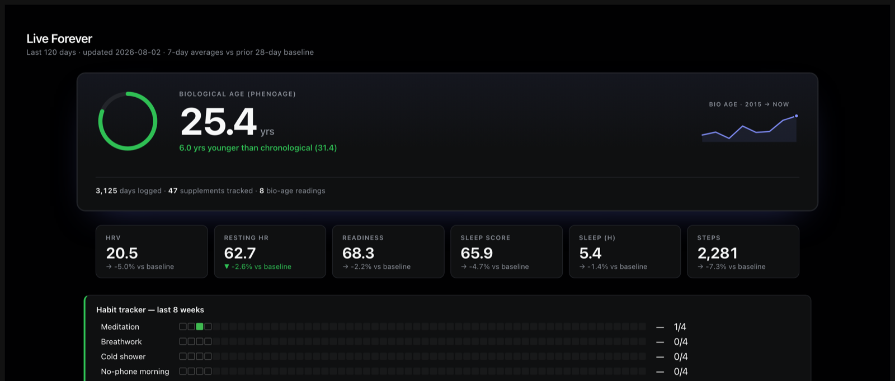
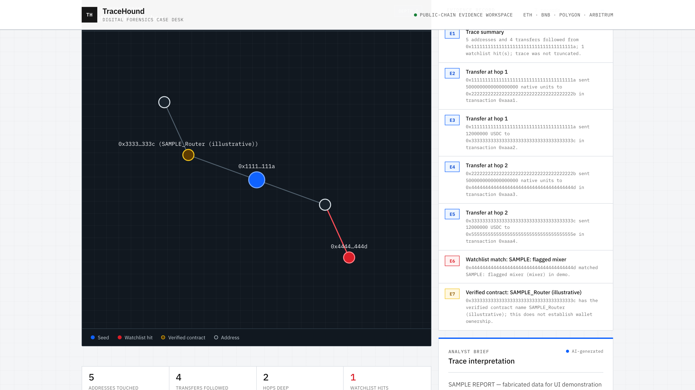
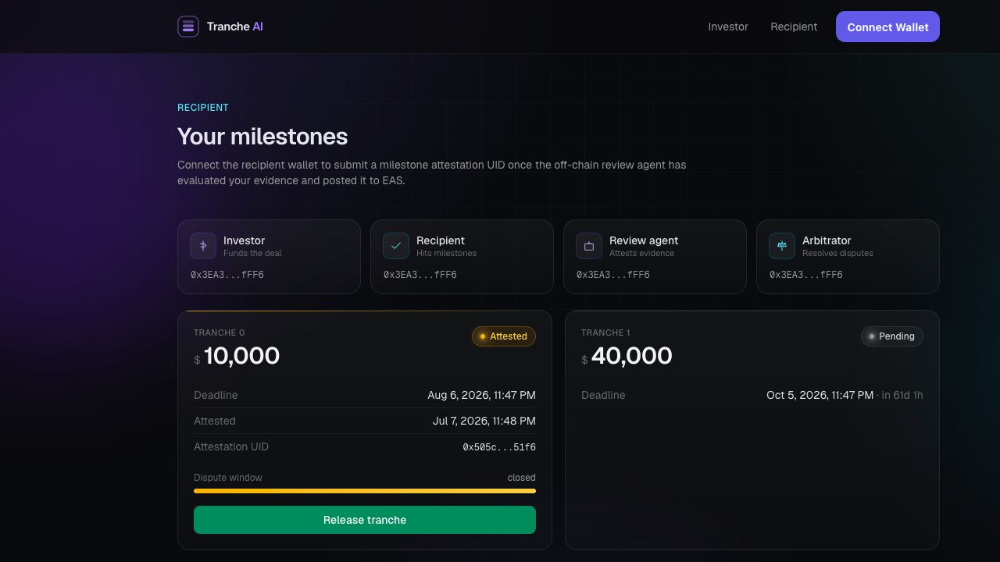
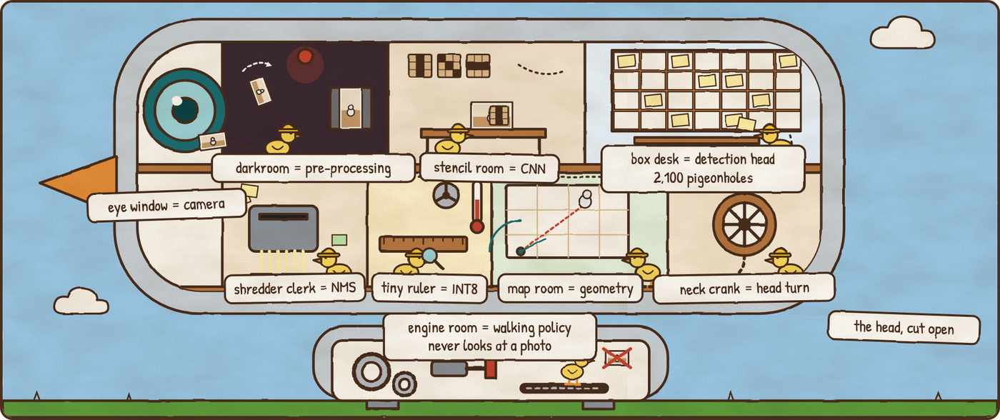

# Hi, I'm Bakul

- 🎓 MBA @ UVA Darden '27 - applied AI operator-builder
- 📫 Badwalb27@darden.virginia.edu
- 🤗 Hugging Face: [huggingface.co/bacool](https://huggingface.co/bacool)

🛠️ **Building across:** bio/longevity · blockchain · VC & PE · AI-native services · physical AI · e-learning

## Featured Projects

**LiveForever** *(live, private)* — personal health control tower unifying wearables (Oura Ring, Apple Health, Whoop), 10+ years of clinical bloodwork & daily self-logged training/habits, and personal genomics (DNA via 23andMe) into one owned data layer.
> **OpenAI Build Week 2026:** [Public version - Live →](https://bakulbadwal.github.io/liveforever-buildweek/) · [Repo](https://github.com/bakulbadwal/liveforever-buildweek)

Benchmarks **PhenoAge** biological-age, N-of-1 correlation analysis quantifying what each input does to HRV, recovery, resilience scores + 28-day analysis on interventions. 

**[TraceHound](https://github.com/bakulbadwal/tracehound) ([Live →](https://tracehound.vercel.app))** — agentic crypto hack tracer: live hop-by-hop tracing and narration from compromised wallet via Etherscan API, cross-references OFAC sanctioned addresses from U.S. Treasury's SDN watchlist, built from experience with federal law enforcement. Also runs as a [read-only MCP server](https://github.com/bakulbadwal/tracehound#mcp-server) for any agent. 

**[Tranche AI](https://github.com/bakulbadwal/tranche-ai) ([Live →](https://tranche-ai.vercel.app))** — condition-gated capital release for VC deals, designed for AI-agent milestone review; smart contract + dispute flow live on Base Sepolia (EAS attestations). Solidity. 

## Hugging Face Learning Labs

Hands-on companions to the Hugging Face courses. Policy Pond and Duck's-Eye View are built around a real robot: [Microduck](https://github.com/pollen-robotics/microduck), a 25 cm open-source robot duck.

**Robot learning labs, in study order:** [Arm Playground](https://bakulbadwal.github.io/arm-playground/) (kinematics and control) → [Demos to Deployment](https://bakulbadwal.github.io/arm-playground/demos-to-deployment/) (imitation learning and real-time execution) → [Inside a VLA](https://bakulbadwal.github.io/arm-playground/inside-a-vla/) (what a vision-language-action model computes) → [Fork in the Road](https://bakulbadwal.github.io/fork-in-the-road/) (diffusion policies) → [Policy Pond](https://bakulbadwal.github.io/policy-pond/) (RL) → [Dual Controls](https://bakulbadwal.github.io/policy-pond/dual-controls/) (RL on real hardware with a human in the loop); for perception, [Duck's-Eye View](https://bakulbadwal.github.io/ducks-eye-view/) → [Eye Exam](https://bakulbadwal.github.io/ducks-eye-view/eye-exam/) (camera calibration).

  
  

- **[Arm Playground](https://github.com/bakulbadwal/arm-playground) ([Live →](https://bakulbadwal.github.io/arm-playground/))** — learning artifact for the Hugging Face Robotics Course: an interactive robot arm with 30 guided lessons on kinematics, configuration space, the Jacobian, and feedback control, ending on the real five-joint SO‑101 in 3D, built from its URDF, plus a playable 3D Workbench where you drive that arm, record your driving as a LeRobot-style episode, replay it blind and train a small policy on it.

- **[Policy Pond](https://github.com/bakulbadwal/policy-pond) ([Live →](https://bakulbadwal.github.io/policy-pond/))** — hands-on deep RL lab for the Hugging Face Deep RL Course: real REINFORCE and PPO running in the browser, all six cases of PPO's clip, GAE's λ, and reward hacking drawn from a real robot duck's training playbook.

- **[Duck's-Eye View](https://github.com/bakulbadwal/ducks-eye-view) ([Live →](https://bakulbadwal.github.io/ducks-eye-view/))** — its sibling, on robot perception, companion to the Hugging Face Computer Vision Course: follow one camera frame through a real robot duck's vision stack, from the letterbox and convolution to YOLO's 2,100 boxes, NMS, an INT8 export bug and the pinhole camera.

- **[Fork in the Road](https://github.com/bakulbadwal/fork-in-the-road) ([Live →](https://bakulbadwal.github.io/fork-in-the-road/))** — hands-on lab for why robots use diffusion to choose actions, companion to the Hugging Face Diffusion Models Course: the real DDPM/DDIM math on a toy town square, from fogging a route map to a robot re-planning around a moving cart.

- **[Demos to Deployment](https://github.com/bakulbadwal/arm-playground/tree/main/demos-to-deployment) ([Live →](https://bakulbadwal.github.io/arm-playground/demos-to-deployment/))** — what comes after the Robotics Course's Unit 2, from Hugging Face's *Robot Learning* tutorial: why behaviour cloning drifts and DAgger fixes it, then every way to execute action chunks while the policy thinks (synchronous, ACT's temporal ensembling, SmolVLA's async queue, Real-Time Chunking), measured on one toy robot.

- **[Inside a VLA](https://github.com/bakulbadwal/arm-playground/tree/main/inside-a-vla) ([Live →](https://bakulbadwal.github.io/arm-playground/inside-a-vla/))** — where the milliseconds go in a robot foundation model: SmolVLA opened floor by floor, from camera frames to tokens, layer skipping, the cached prefix and the action expert's flow steps, timed against the control loop, with π0 side by side.

- **[Eye Exam](https://github.com/bakulbadwal/ducks-eye-view/tree/main/eye-exam) ([Live →](https://bakulbadwal.github.io/ducks-eye-view/eye-exam/))** — Duck's-Eye View's sequel: calibrate a real robot's camera with Zhang's method (OpenCV's `calibrateCamera`), run in the browser from homography to intrinsics, lens distortion and Levenberg–Marquardt.

- **[Dual Controls](https://github.com/bakulbadwal/policy-pond/tree/main/dual-controls) ([Live →](https://bakulbadwal.github.io/policy-pond/dual-controls/))** — Policy Pond's sequel: RL on real hardware with a human in the loop (HIL-SERL, as LeRobot implements it), with soft actor-critic in the browser, a learned reward that gets gamed, and human interventions as training data.

- **[Finishing School](https://github.com/bakulbadwal/finishing-school) ([Live →](https://bakulbadwal.github.io/finishing-school/))** — on post-training: chat templates, LoRA memory fit, DPO's implicit reward and GRPO's group baseline, all exact math, then a capstone that picks SFT, DPO or GRPO for three client briefs.

- **[Reward Arcade](https://github.com/bakulbadwal/reward-arcade) ([Live →](https://bakulbadwal.github.io/reward-arcade/))** — the world the learner practices in, companion to the Hugging Face OpenEnv course: play a real RL environment in the browser, find the answer sheet in its back panel and seal it, send it the moves a good player never would, watch a farmer beat an honest player under a careless reward, and run a tournament with error bars and an A/A test. Sits between Policy Pond and Finishing School.

- **[GAIA Agent](https://github.com/bakulbadwal/gaia-agent) ([Results →](https://bakulbadwal.github.io/gaia-agent/))** — Hugging Face Agents Course capstone (GAIA benchmark): a smolagents code agent with 13 tools, full per-step traces, its own scored practice set with pass^k reliability and ablations, rate-limit and fallback plumbing on open weight models only, and a contamination guard.

## More Projects

- **[AI Stack](https://github.com/bakulbadwal/aistack) ([Live →](https://aistacked.netlify.app/))** — interactive map of the AI industry from silicon to application layer, value accrual, token cost calculator.

- **[Inference Kitchen](https://github.com/bakulbadwal/inference-kitchen) ([Live →](https://bakulbadwal.github.io/inference-kitchen/))** — hands-on lab for serving AI inference: GPU memory and KV cache, batching, and fleet break-even economics.

- **[Compute Deal Desk](https://github.com/bakulbadwal/compute-deal-desk) ([Live →](https://bakulbadwal.github.io/compute-deal-desk/))** — what is one more megawatt worth to us? Hands-on optimization lab for AI compute deals: shadow prices of power and GPUs, take-or-pay vs. “up to,” site portfolios and bid prices, solved live in the browser by a real LP/MIP solver (HiGHS), with a Python twin for every model.

- **[Real Estate Deal Lab](https://github.com/bakulbadwal/real-estate-deal-lab) ([Live →](https://bakulbadwal.github.io/real-estate-deal-lab/))** — every deal is a stack of claims on one building's cash. Nine hands-on deals (loan constant, yield on cost, walk-away price, net effective rent, debt sizing, the waterfall and promote, spec vs. build-to-suit, hold or sell, buy or rent), each ending in a graded call, with an independent Python twin checking every formula.

- **[Robot Payroll](https://github.com/bakulbadwal/aistack/tree/main/robot-payroll) ([Live →](https://aistacked.netlify.app/robot-payroll/))** — when does a robot beat a human shift? Cost per good pick from BLS wages, autonomy as calls for help, payback, NPV and IRR, operator queueing (Erlang C), and the diligence questions to ask a robotics startup.

- **[AI Frontier Dispatch](https://github.com/bakulbadwal/ai-frontier-dispatch)** — personalizable AI + markets briefing: track frontier builders (Grok API for live X read), GitHub/Hugging Face, deals/careers signals. One-line plugin install for any harness.

- **[Deal Docket](https://github.com/bakulbadwal/dealdocket) ([Live →](https://bakulbadwal.github.io/dealdocket/))** — deal-screening dashboard built around an AI-enabled service-roll-up thesis; adjustable five-box scoring framework.

- **Orbit** *(private)* — relationship intelligence engine scores tie strength from live email and LinkedIn records, auto-schedules follow-ups. Obsidian graph + dashboard.

- **[PhaseSignal](https://github.com/bakulbadwal/phasesignal) ([Live →](https://bakulbadwal.github.io/phasesignal/))** — scores live ClinicalTrials.gov data against a base rate, reweighted across four factors.

### Recruiting Trainers

- **[IB Technicals Fluency Trainer](https://github.com/bakulbadwal/ibtrainer)** — merger-model cockpit, purchase-price allocator, DCF sensitivity heatmap - live playgrounds.

- **[Consulting Case Prep Trainer](https://github.com/bakulbadwal/consultingtrainer)** — profit-diagnosis game, market-sizing builder, exhibit reader. Includes a designed [eval harness](https://github.com/bakulbadwal/consultingtrainer/tree/main/evals): golden set, two-axis LLM judge, calibration plan.

- **[The Operator's P&L Room](https://github.com/bakulbadwal/p-lroom)** — eight-quarter run-the-business simulator under leverage & covenants, 13-week cash-crisis room for distress-operator decision making.

## Hackathons

Public builds — [Devpost profile →](https://devpost.com/badwalb)

- **OpenAI Build Week 2026** · Jul 2026 — [Repo](https://github.com/bakulbadwal/liveforever-buildweek)
- **Redesign Health Break the Barrier** · Aug 2026 — [Repo](https://github.com/bakulbadwal/liveforever-care-brief)
- **Google All Things Agentic** · Aug 2026 — [Repo](https://github.com/bakulbadwal/opportunity-radar)
- **AWS Agents for Humans** · Sep 2026 — [Repo](https://github.com/bakulbadwal/recourse)

## Evals

LLM products shipped with tests: **golden set · deterministic policy gate · LLM-judge rubric · calibration plan (TPR/TNR, bias correction)** — each states what's validated vs. designed.

- [TraceHound evals](https://github.com/bakulbadwal/tracehound/tree/main/evals) — executable deterministic gate (`npm run eval`) over a golden set: catches invented hops, false and unsafe claims, missing evidence citations. The [MCP server](https://github.com/bakulbadwal/tracehound#mcp-server) returns cited evidence records with stable IDs to a consuming agent.
- [Consulting Trainer evals](https://github.com/bakulbadwal/consultingtrainer/tree/main/evals) — 12-scenario golden set with deliberate tempting-wrong-answers, two-axis LLM judge with anti-halo instructions, calibration plan.

## Product Case Studies

Short product write-ups — **problem · users · product decisions & tradeoffs · how I'd measure success · roadmap**:

| Project | The product-thinking angle |
|---|---|
| **[TraceHound →](https://github.com/bakulbadwal/tracehound/blob/main/CASE_STUDY.md)** | Agentic AI for underserved users; rigor about a tool's limits |
| **[AI Frontier Dispatch →](https://github.com/bakulbadwal/ai-frontier-dispatch/blob/master/CASE_STUDY.md)** | Generalizing a personal tool for others' setups; borrow vs. build |
| **[Tranche AI →](https://github.com/bakulbadwal/tranche-ai/blob/main/CASE_STUDY.md)** | Scoping a frontier problem in VC |
| **[OpenAI Build Week '26: LiveForever →](https://github.com/bakulbadwal/liveforever-buildweek/blob/main/CASE_STUDY.md)** | Separating deterministic evidence from model interpretation |
| **[The AI Stack →](https://github.com/bakulbadwal/aistack/blob/main/CASE_STUDY.md)** | Mapping where value accrues across AI |
| **[Recruiting Trainer Suite →](https://github.com/bakulbadwal/ibtrainer/blob/main/CASE_STUDY.md)** | Framing three tools as one product line; retention-first design |
| **[PhaseSignal →](https://github.com/bakulbadwal/phasesignal/blob/main/CASE_STUDY.md)** | Transparency vs. black-box incumbents |
| **[Deal Docket →](https://github.com/bakulbadwal/dealdocket/blob/main/CASE_STUDY.md)** | Making assumptions visible; build-vs-backend judgment |
| **[HF Learning Labs →](https://github.com/bakulbadwal/ducks-eye-view/blob/main/CASE_STUDY.md)** | Turning coursework into shipped public artifacts; honesty (exact vs. labelled toy) as a product rule |
| **[Compute Deal Desk →](https://github.com/bakulbadwal/compute-deal-desk/blob/main/CASE_STUDY.md)** | Replacing a spreadsheet course with a solver-backed lab; quoting a shadow price only where it's true |

## How these are built

Most are self-contained apps — vanilla HTML/CSS/JS, no framework, no build step, no dependencies — designed, built, and shipped independently end-to-end with coding agents; I own the product decisions, evaluation, and deployment. Some split data from rendering (`data.json` + `app.js`) for content updates. Some use a real Python data pipeline (`data/build_dataset.py`) that pulls and scores live data. TraceHound is a Next.js app with server-side API keys. 

     
